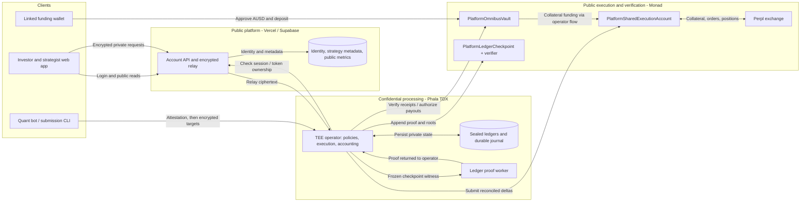
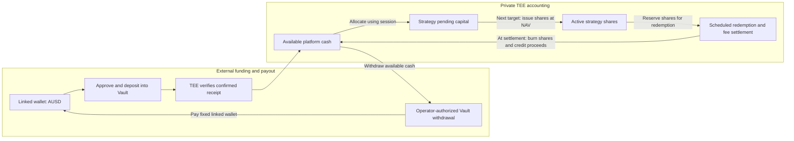
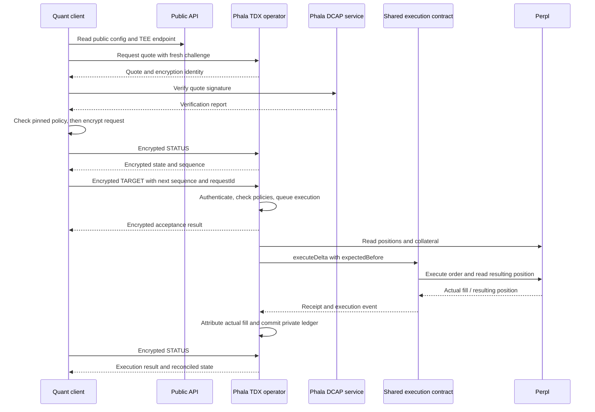

# Veilvest

**Private strategy targets, automated Perpl execution, and verifiable investment accounting.**

Veilvest connects quantitative strategy creators with investors on Monad. Creators submit encrypted portfolio targets; a Trusted Execution Environment (TEE) checks policies and executes position changes on Perpl. Investors compare public strategy terms, allocate capital, hold strategy shares, and redeem through a web interface. Hourly zero-knowledge proofs provide a retrospective audit trail for financial ledger transitions.

Public trading infrastructure can expose strategy intent and investor activity. Private investment services, meanwhile, require users to trust accounting they cannot inspect. Veilvest combines confidential processing with proofs of defined accounting rules, while making its remaining trust assumptions explicit.

**Implementation snapshot: 2026-10-07 · Monad/Perpl testnet MVP.** The diagrams below describe the current platform workflow, not the full historical protocol specification. This date is a documentation baseline, not a claim that the live deployment was revalidated today.

[Open Veilvest](https://mm-zkquant.vercel.app) · [Strategist API](docs/testnet-platform-api.md) · [Account and funding guide](docs/account-login-ux.md)

## Start here

| Goal | Read |
| --- | --- |
| Understand the system | [Architecture](#architecture), [Privacy and trust boundaries](#privacy-and-trust-boundaries) |
| Try the investment workflow | [Investor lifecycle](#investor-lifecycle), [Account and funding UX](docs/account-login-ux.md) |
| Connect a quant strategy | [Submit a strategy](#submit-a-strategy), [Detailed API guide](docs/testnet-platform-api.md), [Daily mean-reversion bot](docs/mean-reversion-bot.md) |
| Check attestation and proofs | [Ledger ZK checkpoints](#ledger-zk-checkpoints), [TEE attestation](docs/platform-tee-attestation.md), [Ledger verification](docs/platform-ledger-zk.md) |
| Develop or operate the platform | [Local development](#local-development), [Platform handoff](docs/e2e-platform-handoff.md), [Team status](docs/team-status.md) |

## Architecture

Veilvest separates public account and strategy metadata from confidential financial processing. The web/API layer handles login, strategy discovery, and public metrics. The TEE handles private requests, execution decisions, investor accounting, and proof generation. Monad contracts provide custody, exchange execution, and a separate accounting checkpoint registry.



Arrows describe responsibilities and data or asset flows; they do not imply that every edge is a direct contract call. The browser sends private requests through the same-origin API relay. The submission CLI encrypts targets locally and sends them directly to the attested TEE endpoint. Plaintext targets and investor allocations are not stored in the public platform database.

The Vault is the common deposit and withdrawal entry point. Collateral used for trading can move into Perpl execution accounts, so funds do not remain entirely inside the Vault during operation. The checkpoint contract audits ledger transitions; it does not hold investor funds or authorize trades.

## Investor lifecycle

An account can browse, register a strategist profile, and obtain API tokens without a wallet. A linked wallet is required for external AUSD funding. Once a confirmed deposit has been credited, allocation and redemption use the login session rather than a new wallet transaction signature.



Allocation, redemption, and external withdrawal are distinct operations. An allocation remains pending until the next target activates it. Redemption settles strategy shares into platform cash at the agreed time; it does not itself send money to a wallet. External withdrawal pays available platform cash to the fixed linked wallet without an additional user transaction signature.

Performance fees use the strategy's configured rate, capped at 20%, and a per-investment high-water mark (HWM). They are not a flat fee on the entire shared account's profit. Integer share calculations and rounding are included in ledger accounting. See the [account guide](docs/account-login-ux.md) for request and settlement behavior.

## Strategy execution

Creators submit desired portfolio exposure rather than individual exchange orders. Each target vector fully replaces the previous vector: positive weights request long exposure, negative weights request short exposure, and omitted or zero-weight markets are targeted for closure. An empty vector requests closure of all strategy positions; actual completion must still be checked.

### Attestation and encrypted submission



The CLI checks a fresh quote against the pinned deployment policy and Phala DCAP verification result before encrypting. The web uses the platform server's verification result from `GET /api/v1/tee-attestation` and relays ciphertext through `/api/tee/encrypted-strategy`. Both paths refuse private submissions when attestation fails.

The encrypted channel uses ECDH, HKDF, and AES-256-GCM. Strategy requests carry authentication, a sequence, and a request ID. `QUEUED` means accepted, not filled: inspect `EXECUTED`, `PARTIALLY_FILLED`, `EXPIRED`, or `FAILED` afterward. The old plaintext target endpoint returns HTTP 410.

### Shared accounts and actual-fill attribution

Compatible strategies can share a Perpl account across markets. The TEE maintains the private mapping between strategies and their attributed positions, while the exchange sees aggregate account positions. Opposing directions in the same market require separate account assignment.

For example, if strategy A owns +6 BTC lots and B owns +4, the shared account holds +10. If A changes its target to +2, its delta is -4 and the aggregate intended position becomes +6. If only -1 lot fills, A owns +5 and the aggregate becomes +9. Recording A as +2 would corrupt the next execution and accounting decision.

[`PlatformSharedExecutionAccount`](contracts/platform/PlatformSharedExecutionAccount.sol) checks operator authority, request reuse, deadlines, open orders, the expected starting position, price bands, leverage bounds, direction changes, and the resulting fill range. These checks constrain public execution, while the TEE remains responsible for converting private strategy intent into the correct delta and attributing results. Separate strategy accounting does not fully isolate exchange account liquidation risk.

### Submit a strategy

Create a strategist profile and strategy, obtain an API token, and allocate capital before requesting a nonzero position. Put `MMQ_API_TOKEN` in your local `.env` or shell environment; keep it out of browser variables and shared logs.

Create `targets.json`:

```json
[
  {"market": 16, "weightBps": 5000},
  {"market": 32, "weightBps": -2000}
]
```

This requests +50% BTC and -20% ETH exposure relative to strategy NAV. These are target exposures, not guaranteed fills.

| Market ID | Asset |
| --- | --- |
| 16 | BTC |
| 32 | ETH |
| 48 | SOL |
| 64 | MON |

```sh
# Submit a full replacement target vector.
node --env-file=.env scripts/submit-strategy.mjs STRATEGY_UUID targets.json

# Read encrypted STATUS without submitting another target.
node --env-file=.env scripts/submit-strategy.mjs STRATEGY_UUID
```

The script fetches the current sequence before submission and generates a request UUID. If a response is uncertain, inspect status before submitting again: rerunning the script creates a new request ID. At the protocol level, retries must preserve the original request ID and payload. See the [API guide](docs/testnet-platform-api.md) and [mean-reversion bot](docs/mean-reversion-bot.md) for integration details. The CLI above uses the hosted platform configuration, even when run from a local checkout.

## Ledger ZK checkpoints

Trading and settlement are not tied to the proof schedule. At regular one-hour checkpoints, the TEE freezes financial state and transition records, replays the records, and checks that they match the snapshot before constructing a private witness.

```mermaid
flowchart LR
    subgraph privateProof ["Private TEE processing"]
        records["Financial transitions and sealed state"]
        snapshot["Freeze checkpoint and replay records"]
        witness["Private witness and Merkle paths"]
        proof["Generate and locally verify Groth16 proof"]
        durable["Persist public proof before advancing local root"]
    end
    subgraph publicProof ["Public audit trail"]
        artifacts["Signed proof payload and public signals"]
        registry["Checkpoint contract checks domain and continuity"]
        verifier["Groth16 verifier"]
        committed["New root, sequence, time and event commitment"]
        reader["Independent verification CLI"]
    end
    records --> snapshot --> witness --> proof --> durable
    durable --> artifacts --> registry
    registry -->|"Verify proof"| verifier
    verifier -->|"Valid proof"| committed
    artifacts --> reader
    committed --> reader
```



The circuit verifies defined financial calculations, including pending deposits, NAV-based share issuance, per-investment HWM fees, share burns, payouts, cash movements, and valuation updates. Investor share totals must match total shares, and constrained balances cannot be negative. Internal cash-to-strategy transfers are matched by the TEE; the circuit does not independently enforce a separate relationship between those books.

Public signals are chain ID, Vault address, sequence, checkpoint time, previous root, next root, and an event commitment. Roots and event commitments are blinded; private investor records, targets, HWM values, and witness paths are not published.

[`PlatformLedgerCheckpoint`](contracts/platform/PlatformLedgerCheckpoint.sol) accepts operator submissions and checks the chain/Vault domain, next sequence, previous root, checkpoint time, and Groth16 proof. Proof history begins at a TEE-authenticated genesis, not a retroactive proof of all earlier activity. A failed checkpoint keeps the last completed checkpoint and reports its state; financial processing can continue.

```sh
npm run verify:tee:platform
npm run verify:ledger-zk
```

These commands perform read-only verification. Ledger verification checks public proofs, signatures, genesis/root continuity, deployed bytecode, transaction calldata, receipts, and events. Quote verification relies on Phala's DCAP service rather than a locally implemented Intel certificate-chain verifier. Public discovery endpoints include `GET /api/v1/ledger-proof-status` and `GET /api/v1/ledger-proofs?after=0&limit=50`.

The current circuit has capacity limits, and exceeding them can stop new proofs while financial processing continues. Its phase-2 setup is a single-participant testnet setup. See [ledger ZK documentation](docs/platform-ledger-zk.md) for capacities, artifacts, deployment addresses, and verification evidence.

## Privacy and trust boundaries

| Information or responsibility | Where it lives / who handles it | Boundary |
| --- | --- | --- |
| Accounts, ownership, sessions and API tokens | Platform API / database | Authentication relies on the platform; the DB stores token hashes |
| Public strategy terms and aggregate metrics | API / database / web | Available for discovery; not proof of investment returns |
| Plaintext targets, investor allocations, share records and witnesses | TEE and sealed state | Not sent as plaintext to the public API/DB |
| Deposits, withdrawals, orders and exchange positions | Public chain / Perpl | Observable; timing and amount correlations remain possible |
| Web attestation result | Platform server and Phala DCAP service | Browser trusts the server result and pinned policy enrollment |
| Delta calculation, external prices/fills and strategy attribution | TEE operator | Ledger proofs do not independently establish external inputs |
| Financial calculations and root continuity | Ledger circuit and checkpoint contract | Retrospective accounting verification; not overall solvency |
| Vault withdrawal authorization | Operator | Contract does not enforce an investor claim proof or independent forced exit |

TEE attestation, execution contract checks, and ledger proofs serve different purposes. Attestation identifies an accepted environment; contract checks constrain exchange actions; ZK proofs verify encoded accounting transitions. None alone establishes every property of the platform. The current platform does not ZK-preauthorize every order, fully isolate shared-account liquidation risk, or implement committee Forced Exit. The encrypted channel also does not claim full forward secrecy if the fixed TEE encryption key is compromised.

## Recovery and operations

Financial execution follows a durable sequence: sign the transaction, fsync the encrypted journal, submit, reconcile the receipt, then commit the ledger. If submission status is uncertain, recovery checks the existing hash, nonce, and receipt and can resend the same signed transaction. It does not replace an uncertain transaction with a fresh nonce. Persisted proofs are reused after a restart when available.

Recovery requires the existing identity, keys, and persistent state. Ledger mismatches, nonce rollback, or proof failures must remain visible; recovery may safely stop rather than fabricate continuity or initialize a new genesis.

Hosting uses Vercel `mm-zkquant`, Supabase `monad`, and the existing Phala CVM. Worker updates preserve the keys, sealed ledger, Vault, and genesis. Verify the control-plane compose, runtime hashes, and fresh quote before updating pins and deploying the matching web/API. Routine web/worker updates do not require redeploying the Vault. Set `PHALA_CVM_ID` explicitly for worker updates and enrollment. Account migrations preserve the original operator and financial state through an encrypted TEE-to-TEE transfer; see the [Phala account migration runbook](docs/phala-account-migration.md). See also [attestation operations](docs/platform-tee-attestation.md) and [gas recovery](docs/platform-gas-recovery.md).

## Local development

Use Node **22.13 or newer**, as specified by [package.json](package.json). Configure `.env` from [.env.example](.env.example). The API needs PostgreSQL; confidential execution additionally requires an available TEE deployment and matching attestation policy. Starting the web/API locally does not provision a TEE or new contracts.

```sh
npm ci
cp .env.example .env
```

Set `DATABASE_URL` for your database. For a local PostgreSQL container, the following command keeps PostgreSQL in the foreground; use another terminal for migrations and the application:

```sh
docker run --rm --name mmq-pg -p 127.0.0.1:5432:5432 \
  -e POSTGRES_HOST_AUTH_METHOD=trust -e POSTGRES_DB=mmq postgres:17
```

For this local container, set the following in `.env`, leaving other settings intact:

```dotenv
DATABASE_URL=postgresql://postgres@localhost:5432/mmq
```

```sh
npm run db:migrate
npm run dev
```

The web app is available at http://localhost:5173 by default, and the platform API uses port 8789. Migrations require write access to the configured database. Configure the TEE endpoint and encryption public key for confidential requests; the deployed policy pins must match the environment.

### Validation commands

| Command | Scope |
| --- | --- |
| `npm test` | Current platform regression suite |
| `npm run test:contracts` | Vault and shared execution account on a local EVM |
| `npm run test:ledger-zk` | Witnesses, real proofs, verifier contract and retries |
| `npm run build` | Frontend build |
| `npm run verify:tee:platform` | Fresh quote verification of the hosted deployment, read-only |
| `npm run verify:ledger-zk` | Public proofs and chain records, read-only |

`npm run test:all` also includes historical research and protocol reference models. Do not conflate its historical counts with the current platform suite. See [team status](docs/team-status.md) for dated validation records.

Judge credentials belong only in the ignored local `.data/judge-accounts/access.md`. The setup fixture and account E2E can move real testnet funds; follow the [account guide](docs/account-login-ux.md). Do not commit private keys, sessions, API tokens, witnesses, or private ledgers.

## Repository map

| Path | Purpose |
| --- | --- |
| [src/platform/](src/platform/) | Account API, database access, policy validation, attestation and relay |
| [deploy/tee/operator/](deploy/tee/operator/) | Confidential execution, cash and strategy ledgers, shared accounts, journaling and proofs |
| [scripts/submit-strategy.mjs](scripts/submit-strategy.mjs) | Attestation-gated encrypted target submission and status reads |
| [contracts/platform/](contracts/platform/) | Vault, execution accounts and ledger checkpoint contract |
| [circuits/platform-ledger-transition.circom](circuits/platform-ledger-transition.circom) | Current platform financial transition circuit |
| [protocol/platform/](protocol/platform/) | Ledger witness construction and contract tooling |
| [db/migrations/](db/migrations/) | Platform database schema migrations |
| [tests/](tests/) | Platform, contract, proof and historical research tests |
| [docs/](docs/) | Integration guides, operational procedures, specifications and evidence |

## Historical specifications and experiments

The [original specification from 2026-09-23](docs/specs/README.md) describes the intended Trade/Lease/Anchor/Ledger design and committee exit path. Those goals are broader than the current platform's guarantees; use the implementation and current platform guides to assess what is available.

- [10/04 cohort MVP](docs/2026-10-04-core-cohort-mvp.md): Two investors, a closing ledger, direct TEE submission and payout verification
- [Perpl execution core](docs/core-mvp.md), [protocol reference model](protocol/README.md)
- [Previous README](docs/archive/readme-before-perpl.md)

VM shutdowns, costs, transaction counts and test counts in these records describe their experiment dates, not the live platform's present operational status.
