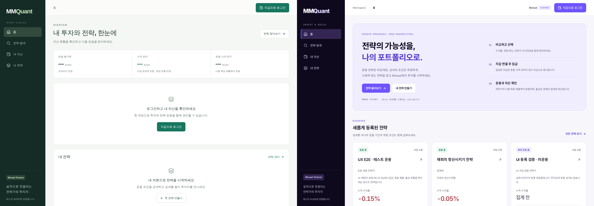
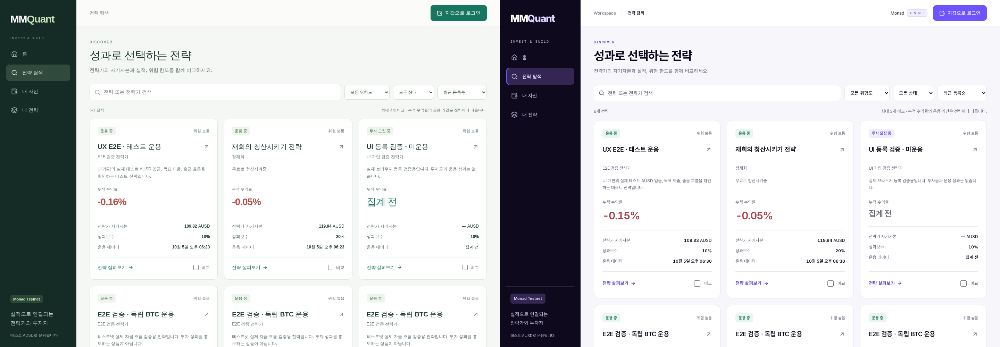

# Monad UI design QA

final result: passed

Date: 2026-10-05. Scope: existing MMQuant product, updated to the official Monad palette. This is an intentional redesign of the existing code target, not a pixel clone of Monad's marketing site. Base commit: `7a3ff0d`.

## Source and implementation evidence

Source truth: this run's `docs/design/images/before-home.png`, `before-explore.png`, `before-assets.png`, `before-manage.png`; official color/typography reference at https://monad.xyz/brand-and-media-kit, captured as `.data/design/brand-reference.png`.

Rendered implementation: `docs/design/images/after-home.png`, `after-explore.png`, `after-explore-320.png`, `after-comparison-mobile.png`. Additional original captures for detail, tablet, assets, manager and confirmation states are local in `.data/design/` and `.data/ux-review/`. Private test-account screenshots are not committed.

Desktop source and implementation viewport: 1440 × 1000 CSS px, device scale factor 1. Each full-page image has a 1440px intrinsic width and content-dependent height. Mobile: 390 × 844 and 320 × 844 CSS px at density 1. Tablet: 768 × 844. Authenticated tests: 1280 × 900 and 390 × 844. Full-page captures display the fixed navigation at its actual viewport position; they do not represent an exceptionally tall device.

Full-view comparison inputs: the original full-page before and after captures were inspected. The combined `comparison-home.png` and `comparison-explore.png` place the top 1000px of each 1440px source and implementation side by side on a 2880 × 1000 canvas, without rescaling. The first home loading capture was rejected as final evidence and replaced with the loaded catalog. Live prices and observation timestamps differ between captures.

Focused evidence: `after-comparison-mobile.png` for table and floating controls, `after-explore-320.png` for the corrected narrow header; local `manager-investment-confirm.png` for dialog typography, input labels and modal behavior, and `manager-assets-desktop.png` for corrected table colors.

## Findings and iteration history

1. P2, original palette and type: green navigation/actions and low-emphasis small labels did not express the requested Monad direction. Replaced literal platform colors with semantic tokens, loaded Inter/Noto Sans KR/Roboto Mono, strengthened titles and secondary text. Post-fix: the combined home/explore inputs show consistent purple/ink/light surfaces. Brand colors match the official palette; neutral and status colors are explicit product extensions.
2. P2, logged-out home: repeated login/empty states occupied the first view. Replaced with an introduction, two clear actions, three-step explanation and real recent strategies. This layout change is intentional. Post-fix: loaded `after-home.png`; authenticated dashboard remains available.
3. P2, comparison discoverability: selection had no persistent action or explicit fourth-item limit. Added a dock, selected-card boundary, disabled unchecked items at three, a clear-selection action and a focusable scroll region. Post-fix: mobile comparison screenshot, selection and keyboard tests.
4. P2, first implementation's table: legacy global `td` color and `th` size leaked green and undersized labels into assets. Scoped current-product table colors and header typography. Post-fix: final authenticated asset capture shows ink-colored cells and legible headers.
5. P2, 320px header: login label wrapped. Removed the compact network badge only below 361px and preserved the testnet disclosure elsewhere. Post-fix: `after-explore-320.png` shows one-line login with no document overflow.
6. P2, missing data: unknown returns used positive color and null chart metrics could become 0. Neutralized unavailable statistics, retained missing chart values as gaps and kept their table entries as “집계 전”. Browser check with null history confirms that no zero-valued chart is fabricated.
7. Accessibility: dialog now has an associated title, input a stable accessible name and invalid state, account Escape restores trigger focus, and comparison action focuses its destination. Real test-account confirmation dialogs were opened and dismissed without transaction submission.

No actionable P0/P1/P2 findings remain within the verified scope.

## Required surfaces

- Typography: heading/body/mono roles, Korean fallback, weights, numeric alignment and line wrapping inspected. Inter is used for product headings instead of the official licensed Britti Sans; this is intentional, not a fidelity claim. Fonts use swap and system fallback.
- Spacing: retained established app routes and navigation architecture, adjusted sidebar to 232px on desktop, consistent 16px card radii and 44px primary controls. Tested 320/390/768/1440px; no document overflow in 20 route/viewport combinations. Tables scroll within their container.
- Colors: official Primary `#6E54FF`, Lavender `#DDD7FE`, Ink `#0E091C`; product neutrals and status colors are separate. White on primary: 4.80:1; muted on canvas: 5.26:1; purple text on soft: 6.44:1. Positive/negative values retain semantic colors and signs.
- Assets: existing MMQuant wordmark and Lucide icons retained. No Monad logo imitation, raster placeholders or generated illustrations introduced. Public performance uses live API content, not invented metrics.
- Copy: testnet, pending capital, next-target activation, private signed asset lookup and TEE-only public metrics remain explicit. Current metadata replaces the old paper-execution description.

## Verification

- `npm run build`: passed. Existing Lucide “use client” bundler notices are non-fatal.
- `npm test`: 28 passed.
- `scripts/platform-ux-browser.mjs`: public search, filter reset, three-way comparison, focus, deep-link reload; manager and investor login, private portfolio, account Escape, investment confirmation/close, tabs, invalid target blocking, session restoration and account-change cleanup. Passed with no page JavaScript errors. Direct Phala browser connections were blocked to exercise the existing encrypted relay. Transaction sending was disabled.
- Four viewport sizes, five public routes: no document overflow; no page JavaScript errors.
- Focused comparison keyboard scroll and null-history checks passed.

## Remaining limits and follow-up

No new onchain deposits, orders or withdrawals were sent. The success-state step indicator follows the existing deposit result but a fresh payment was not performed. Full screen-reader testing, Safari/Android hardware and 400% zoom remain outside this pass. Optional P3: self-host approved font subsets to remove the external font request.

Implementation checklist: palette and shared components complete; guest onboarding and comparison complete; responsive and keyboard checks complete; review and public evidence saved. Deployment is recorded separately after Vercel confirms its URL.
