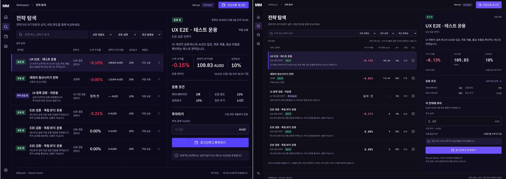

# Compact Monad workspace — design QA

final result: passed

Date: 2026-10-05. Branch: `design/monad-ui`. This report supersedes the earlier light dashboard review, which the user rejected. The selected visual is `exec-62044902-d542-4ada-8c59-8131e01fbafe.png`.

## Source and browser evidence

- Source visual truth: `docs/design/images/split-reference.png` (1488 × 1056 pixels).
- Implementation: `docs/design/images/split-desktop.png`, captured with Playwright Chromium at 1488 × 1056 CSS px, device density 1, logged out, default sorting, first strategy selected.
- Full-view comparison: `docs/design/images/split-comparison.png` (2976 × 1056), source left and rendered implementation right; neither is stretched. Both opened and visually inspected together.
- Responsive evidence: `split-mobile-390.png`, `split-mobile-320.png`, `split-detail-mobile.png` in the same directory. Mobile viewport heights are 844 CSS px; full-page captures include content below the fold, with navigation fixed at its actual viewport position.
- Focused regions inspected: list numeric columns, selected boundary, inspector metrics and investment form; mobile capital figures and comparison dock. Private account captures remain in ignored `.data/ux-review/`.

## Findings and fixes

1. P1: prior light cards and welcome hero did not match the selected operational workspace. Replaced with a 64px icon rail, 58px header, dense rows, and a 500px inspector at the reference viewport. All six current strategies fit in the initial desktop screen. Evidence: final combined screenshot.
2. P2: initial split had an overly narrow inspector and small return values caused by CSS specificity. Corrected the panel proportion and numeric typography; preserved tabular numerals. Evidence: final desktop screenshot.
3. P2: row description and status stacked into excessive height. Grouped manager and status in a byline, clamped the secondary desktop description, retained the full description in the inspector/detail. Final rows are approximately 104px high.
4. P2: shared detail statistic layout squeezed mobile manager capital into broken lines. Scoped horizontal layout to the summary ribbon; portfolio statistics now wrap as independent labeled values. Evidence: final 320px detail screenshot.
5. P2: desktop minimum columns could collide with the inspector near 1180px. Reduced fixed column widths and uses a 380px inspector through 1350px. No document overflow at 1180/1280px. Below 1180px, selecting a row opens the existing detail route.
6. P2: dark chart hover could inherit a white tooltip. Scoped tooltip foreground, background and border to dark semantic tokens.

No actionable P0/P1/P2 remains in the verified scope.

## Design surfaces and intentional differences

- Typography: Inter/Noto Sans KR body, Roboto Mono for figures; restrained weights and compact labels. Reference hierarchy retained, with 26px inspector title and 25px inspector metrics. Korean fallback and wrapping inspected. Generated image letterforms are interpreted with available fonts.
- Layout: flat rows, thin dividers, 4–6px corner radii, no large introductory cards. Mobile uses labeled metrics, bottom navigation and a direct investment jump in the detail route. No separate mobile reference was provided; this is the responsive adaptation requested by the user.
- Colors: Monad primary #6E54FF and lavender #DDD7FE, extended near-black purple product surfaces. Semantic green/red remain alongside text status and signed return values. Muted copy remains visibly distinct on dark surfaces.
- Assets: existing MM wordmark and Lucide line icons retained; no raster illustration exists in the chosen target requiring generation. The background is a flat product surface rather than reproducing image-generation texture.
- Copy and data: existing live API values, no invented performance. Missing statistics remain unknown. TEE-only metrics, test AUSD, pending activation and settlement timing remain explicit.
- Product adaptations: manager identity is grouped under the strategy name; explicit compare checkboxes preserve the existing three-way comparison feature; an inspector link opens full performance/history. Real balance and settlement details remain in the investment form, unlike the simplified mockup.

## Verification

- `npm test`: 28 passed.
- `npm run build`: passed; existing Lucide module directive warnings are non-fatal.
- `scripts/platform-ux-browser.mjs`: public search/reset/filter/sort, three-way comparison and focus, desktop inspector selection, full detail deep-link/reload; manager and investor login, private portfolio through encrypted relay, account Escape/focus, investment confirmation/Escape, management tabs, invalid allocation blocking, session restoration and wallet-change cleanup. Passed, zero page JavaScript errors. Transaction submission disabled.
- Playwright visual sweep: 30 combinations across 1488, 1280, 1180, 768, 390, 320px and home/explore/detail/assets/manage; zero document overflow and zero page JavaScript errors. Mobile comparison limit and focus, reset and empty-search state passed.
- Final mobile row navigation to actual detail route confirmed; final screenshots inspected after statistic-layout repair.

## Follow-up polish and limits

Optional P3: self-host approved font subsets. No fresh deposits, trades or withdrawals were sent. Safari, physical mobile devices and a full screen-reader audit remain outside this pass. Earlier `after-*` and `comparison-*` images are historical light-design evidence; `split-*` files represent this release.

## Production verification

Code commit `2e89658` deployed successfully to https://mm-zkquant.vercel.app. Immutable deployment: https://mm-zkquant-4zcwzqprc-cosmoserys-projects.vercel.app (Vercel READY).

Post-deployment Playwright verified desktop row selection/inspector update, comparison focus, 390px row-to-detail navigation and deep-link reload. No document overflow or page JavaScript errors. Production screenshots in `.data/design/production-split-desktop.png` and `production-split-mobile.png` were inspected. Original main workspace uncommitted work remains excluded and unchanged.
