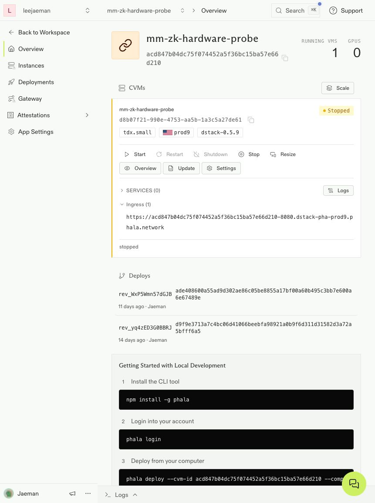

# 실제 TEE → 공개 Perpl 검증 · 2026-10-04

> **최신 후속 구현:** 장부 전이·중단 재개·TEE 내부 제출·2인 지분/보수/출금을 하나의 공개 운용 주기로 통과했다. [최신 결과](2026-10-04-core-cohort-mvp.md). terminal cohort MVP 범위이며 아래 이전 실험과 전체 v1 마일스톤을 구분한다.


**실제 Phala TDX에서 생성한 증명으로 공개 Monad 테스트넷 Perpl의 진입·종료·담보 회수를 통과했다.** 10월 3일 로컬 prover 실험과 별개의 새 계정·트랜잭션이며, 두 실험을 이어 붙여 성공으로 계산하지 않았다.

## 실행한 흐름

클라이언트가 합성 목표를 서명하고, 새 challenge로 TDX quote·암호화 공개키·배포 compose hash·코드/회로 산출물 hash를 확인했다. 서명된 입력을 암호화해 TEE로 보냈으며 TEE가 Groth16 증명을 생성했다. 클라이언트는 암호화 응답의 nonce·공개 입력·증명을 검증한 뒤 공개 테스트넷에 제출했다. 거래 계약이 같은 트랜잭션에서 증명을 검증하고 Perpl 주문을 실행했다.

**전략 입력 작성·서명·트랜잭션 제출은 아직 로컬이다.** TEE 내부 전략 엔진·relayer·장기 키 보관을 구현한 것이 아니다. 목표·현재 수량·계정은 이 실험의 공개 입력이므로 비공개 주문/귀속을 보장하지 않는다.

## 실제 결과

| Product / Perpl 계정 | 입금 테스트 AUSD | 최초 실제 포지션 | 최종 포지션 | 회수 테스트 AUSD |
|---|---:|---:|---:|---:|
| A / 807 | 100 | 100 lot | 0 | 99.934363 |
| B / 808 | 100 | -100 lot | 0 | 99.921249 |

- 13개 공개 트랜잭션, 하드웨어 생성 증명 4개. A 왕복 후 B 왕복을 순차 실행했다.
- 가스 **1.61843808 테스트 MON**. 새 faucet 수령 없이 기존 테스트 담보 중 200개를 사용했다.
- 종료 지갑 잔액 **9999.668901 테스트 AUSD**. 회수액 차이는 비용과 매매 손익이며 전략 수익성 지표가 아니다.
- 증명 생성 시간 3,231 / 2,938 / 3,048 / 3,245ms. 전송·체결까지의 종단 지연이 아니며, 다른 전체 TradeCircuit의 300ms 성능 합격으로 해석하지 않는다.
- 별도 온체인 검증: 영수증·배포 코드·증명·실제 전후 포지션·Transfer·잔액 보존, 4개 execute tx의 verifier→Perpl 호출 순서를 재확인했다.
- 최종 포지션·주문·자유/잠금 담보·계약 잔액·allowance 모두 0.
- VM 종료 후 완료 세션 재실행: 추가 트랜잭션 **0건**. 하드웨어를 재가동하지 않고 기존 영수증을 재확인했다.

| 단계 | 공개 탐색기 |
|---|---|
| open-A | [0x56a7ce5078…](https://testnet.monadscan.com/tx/0x56a7ce50783860d1fa9dd2e8b9f533cc858c684e25ee1cc4eea3abaef8de8c36) |
| close-A-0 | [0x7b256d8964…](https://testnet.monadscan.com/tx/0x7b256d8964ae24902e12445a97949dc3461c7d428d9c643c6f56c6b00ad2ccca) |
| recover-A | [0x1a7d2c8456…](https://testnet.monadscan.com/tx/0x1a7d2c8456dcf3fcb2da5d1cdaba8f98dbf76e129414c72448077d3c64082b1d) |
| open-B | [0x02cff88f0f…](https://testnet.monadscan.com/tx/0x02cff88f0fdcaae60a2127a8df5bea3a8b54721de0c1e435c2d8fc294e7dabb1) |
| close-B-0 | [0x9669ba10c1…](https://testnet.monadscan.com/tx/0x9669ba10c131b53efe1f2dcf49b736b9cf60262e6f5e9992ffa60b3e93561eb0) |
| recover-B | [0x5ecfb74e47…](https://testnet.monadscan.com/tx/0x5ecfb74e47f4a58e958cc43bf57fba2e05c5293482b052291b60ea706b36132c) |

## 팀원 재검증

```sh
npm ci
npm run verify:perpl:tee:testnet
```

키·TEE 재가동·`.data`·proving key 없이 공개 체인과 Phala quote 검증 API를 조회한다. 이 파일들을 제외한 별도 폴더에서도 두 검증기 통과를 확인했다. 기존 JS 검사 422개와 로컬 포크 runner 리허설도 통과했다. 첫 검증기는 실제 거래를 확인하고, 두 번째는 저장된 TDX quote 서명·이벤트 로그·코드·challenge 결합을 재검증한다. 과거 challenge를 다시 읽는 것이므로 현재 시점의 새 하드웨어 접속 검사는 아니다. 저장된 증명 응답 자체에 별도 하드웨어 서명은 없으며, 생성 당시 클라이언트가 quote에 결합된 암호화 키로 응답을 검증했다는 한계가 있다. 공급자 API와 실험용 단독 Groth16 setup에 대한 신뢰도 남는다.

[실행 증거](evidence/perpl-tee-testnet-mvp.json), [온체인 별도 검증](evidence/perpl-tee-testnet-audit.json), [TDX 재검증](evidence/perpl-tee-testnet-attestation-audit.json).

새 실행은 기존 승인 VM과 client manifest를 준비한 뒤 `MM_PERPL_TEE_ENDPOINT=<HTTPS ingress> npm run prove:perpl:tee:testnet`으로 수행한다. 로컬 세션과 `.data/perpl-tee-testnet`을 분리했으며 TEE 실패 시 로컬 증명으로 대체하지 않는다. 완료 후 반드시 VM Shutdown과 Stopped를 확인한다. 기존 키/산출물을 교체하면 진행 중 세션을 복구할 수 없으므로 재빌드하지 않는다.

## 종료와 비용

기존 VM을 약 3분간 재사용하고 **Stopped** 상태를 확인했다. Compose·머신 크기 변경이나 신규 배포는 없었다. 실험 전·종료 후 Billing은 prepaid, auto-topup off, 크레딧 $19.03이었다. $20 초기 지급 대비 누적 차감 관측은 $0.97이며 기존 $2 상한을 늘리지 않았다. 반올림·과금 반영 지연 때문에 이번 실행의 확정 비용을 0으로 단정하지 않는다. 중지된 디스크 보관 비용은 계속 남을 수 있다.



## 남은 코어 작업과 합격 기준

| 순서 | 아직 필요한 구현 | 통과 기준 |
|---|---|---|
| 1. 실제 체결을 반영하는 장부 전이 | Product별 이전 장부·인증된 실제 체결/잔액·입출금으로 다음 장부를 만들고 ZK로 검증 | 목표와 실제 체결이 달라도 실제 결과만 반영. 다른 Product 결과·중복 결과·조작한 잔액 거절. 자본 보존. 현재 목표 승인 proof와 별도 회로 필요 |
| 2. 중단 후 안전한 재개 | 전송 직전/직후 crash, 응답 유실, 부분 종료, 만료 시 상태 복구 | 체인 영수증과 nonce로 재조정하고 중복 주문·중복 회수 없음. 지금 통과한 것은 완료 세션 재실행뿐 |
| 3. TEE 운용 경로 | 전략 수신·정책 검사·키 갱신·TEE 내부 제출·재시작 복구 | 호스트 로그에 평문 없음, 폐기된 키 거절, 상태 rollback 거절. PRIVATE_ONLY를 일반 RPC로 대체하지 않음 |
| 4. 투자자 회계·출구 | 지분·보수·대기 출금 및 비동기 증거금 회수 | 입출금·손익·수수료 합계 보존, 중복 claim 거절, 유동성 부족 시 대기 상태 유지 |

해커톤 코어의 다음 우선순위는 **1과 2**다. 공유 slot 프라이버시·committee Forced Exit·운영 보안 감사는 더 큰 제품 범위로 남는다. 이번 결과는 TEE/체인/거래소 연결 가능성을 입증하며 전체 프로토콜 구현 완료는 아니다.
