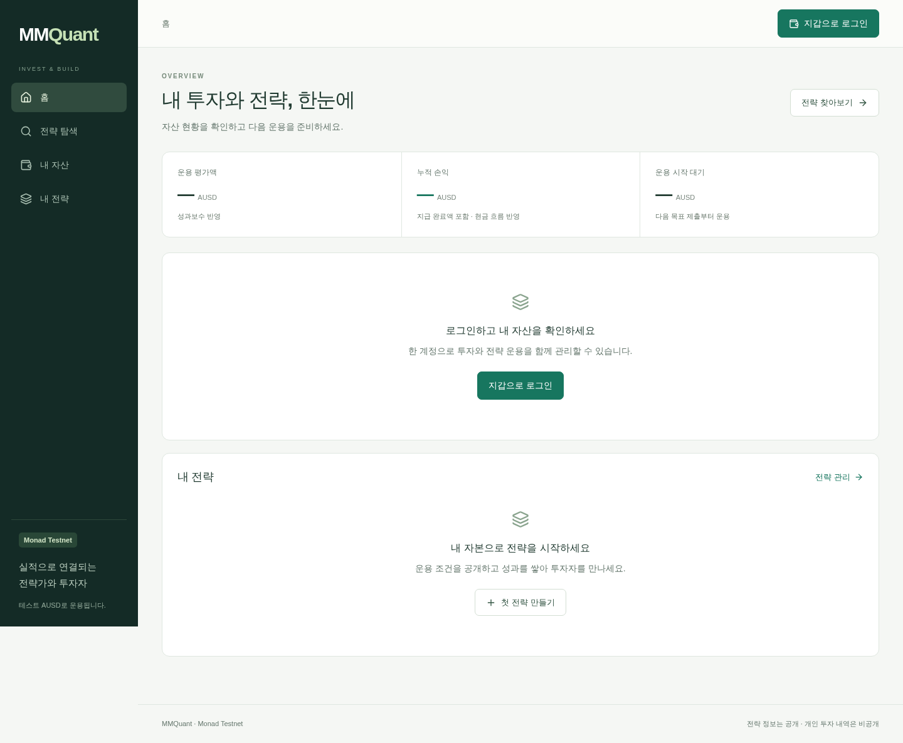
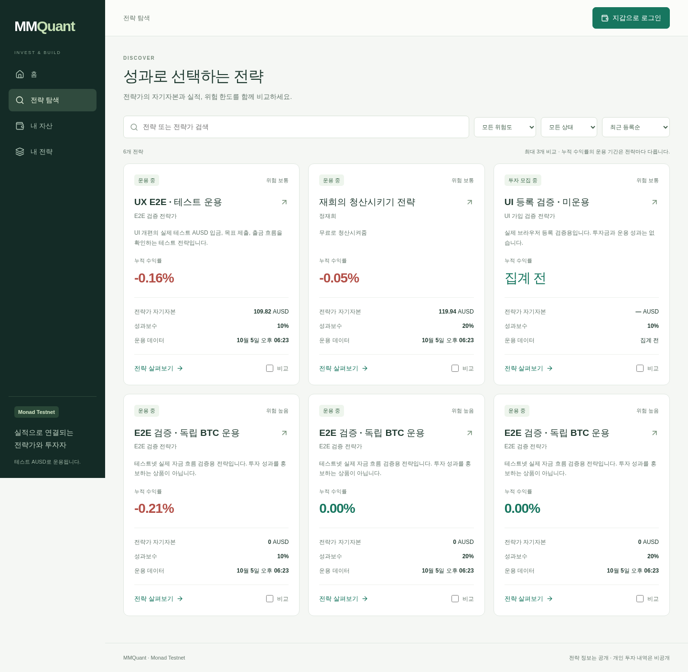
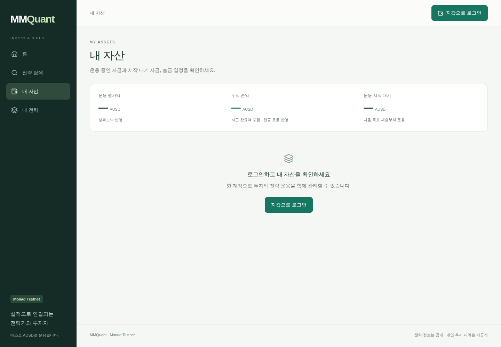
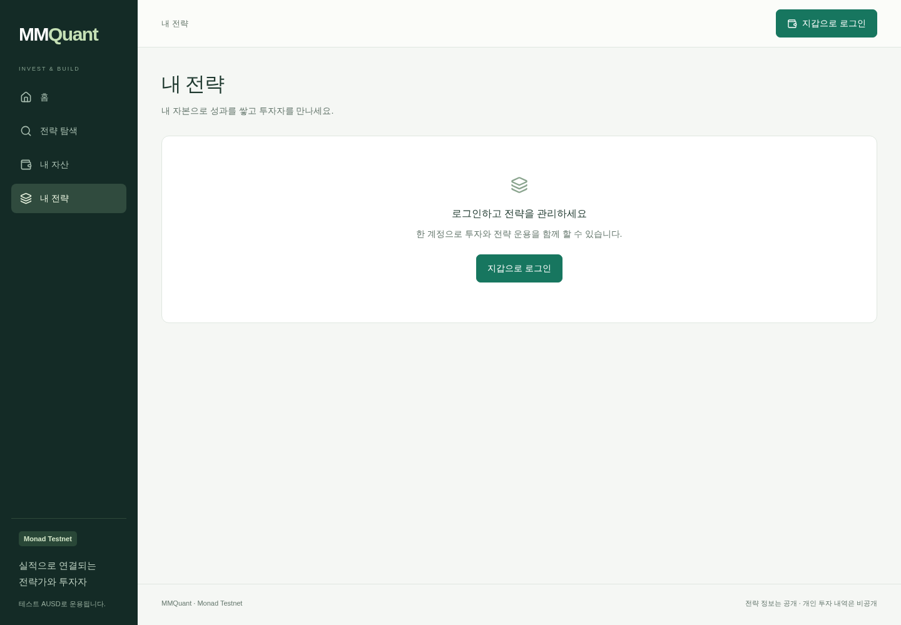
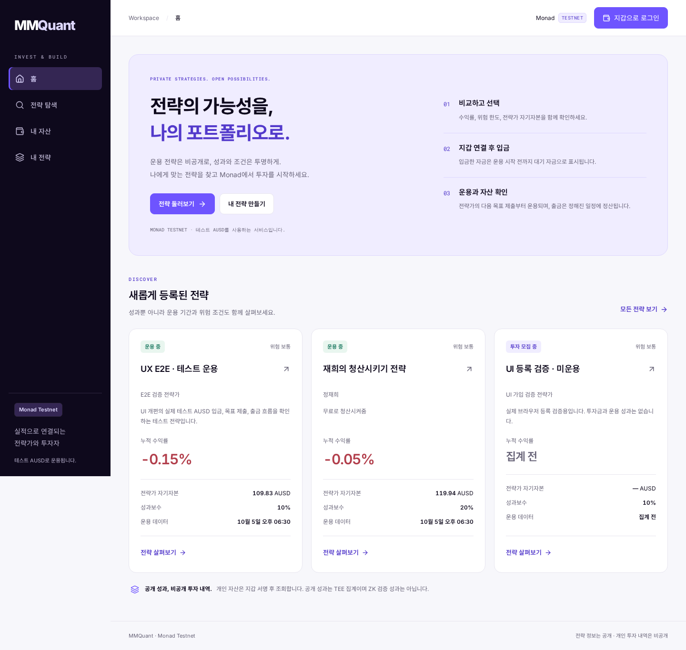
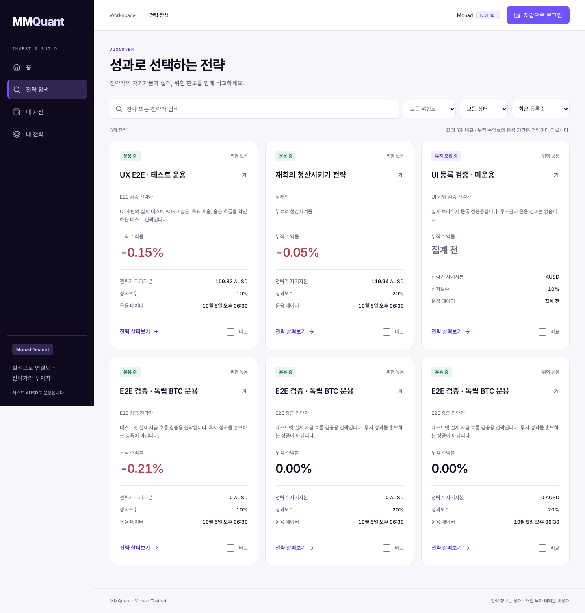

# Monad UI 검토와 디자인 시스템

2026-10-05. `7a3ff0d`의 커밋된 제품을 기준으로 검토하고 `design/monad-ui`에서 개선했다. 원래 작업 폴더의 미커밋 변경은 포함하지 않았다. 검토 범위는 현재 사용자 플랫폼의 문서·화면·공통 컴포넌트·상태 처리이며, 계약과 암호화 프로토콜 전체에 대한 보안 감사는 아니다.

## 프로젝트와 제품 경계

- `src/web/Platform.jsx`가 홈, 전략 탐색, 공개 전략 상세와 앱 내비게이션을 구성한다. `InvestorPortal`은 자산·출금, `InvestmentPanel`은 입금, `ManagerConsole`은 등록·목표 제출·실행 내역·운용 조건·API 연동을 담당한다.
- `PlatformContext`는 공통 지갑 인증, 카탈로그, 암호화 개인 조회 및 투자 요청을 연결한다. `src/platform`과 `api`는 공개 API와 암호문 중계, `deploy/tee/operator`는 비공개 장부와 실행 경로다.
- `contracts`, `circuits`, `protocol`, `research`에는 계약·ZK 실험·참조 모델·연구 기록이 있다. 현재 플랫폼의 모든 실행이 ZK 검증을 거치는 것은 아니다. 공개 성과도 TEE 집계로 표시한다.
- `App.jsx`의 `/legacy`, `/demo`, `/domains/` 해시 경로는 이전 검토 화면이다. 이번 디자인의 대상은 실제 URL을 사용하는 현재 플랫폼이다.
- 기준 문서: `README.md`, `CONTEXT.md`, `docs/e2e-platform-handoff.md`, `docs/ux-platform-handoff.md`. 예전 프로토콜 목표와 현재 제품 동작을 구별해야 한다. 이번 작업은 자금·계정 배정·출금 정산 로직을 변경하지 않았다.

## 화면 검토

캡처는 이번 작업의 커밋 기준 로컬 프런트엔드에서 생성했다. 공개 API는 기존 배포의 실제 데이터를 조회했다. 상태나 수익률은 캡처 시점에 따라 변한다.

### 1 홈

기존 상태: 개선 필요. 로그인 전 금액 자리와 로그인 안내가 큰 영역을 차지하며, 투자자와 전략가의 첫 행동이 반복된 빈 패널 안에 있었다. 탐색은 로그인 없이 가능한데 화면에서는 그 가치가 약했다.

개선: 전략 탐색과 전략 만들기를 첫 행동으로 제시하고 실제 최근 등록 전략 3개를 보여준다. 투자 순서와 테스트넷 안내를 제공한다. 로그인 후에는 기존 개인 대시보드를 유지한다.

### 2 전략 탐색과 비교

기존 상태: 기능은 양호, 발견성과 상태 표현 개선 필요. 검색·위험도·운용 상태·정렬·비교가 이미 구현돼 있었다. 비교 결과는 긴 목록 아래에 있고, 네 번째 선택은 반응 없이 거절됐다. `집계 전`이 양수 수익과 같은 초록색으로 표현됐다.

개선: 고정 비교 바, 선택 카드 테두리, 최대 3개 제한의 명시, 필터 초기화, 별도 로딩 스켈레톤, 중립적인 미집계·0% 표현. 비교표는 키보드로 초점을 받고 좌우 스크롤할 수 있다.

### 3 개인 자산

기존 상태: 정보 구분은 양호. 서명 전 값을 0으로 꾸미지 않고, 운용 평가액·대기 자금·현금흐름을 구분한다. 작은 보조 글자와 기존 전역 표 스타일은 가독성과 색상 일관성을 약화했다.

개선: 공통 토큰·숫자 정렬·보조 글자·표 스타일을 적용했다. 실제 테스트 계정의 자산 조회·복원·지갑 변경 후 초기화를 브라우저에서 확인했다.

### 4 전략가 진입과 관리

기존 상태: 인증 경계는 양호. 가입 단계와 목표 제출·실행 내역·조건·API 탭이 구성돼 있다. 투자자 화면과 동일한 타이포그래피·입력·상태 규칙이 필요했다.

개선: 공통 폼·탭·포커스·모바일 입력 스타일을 적용했다. 실제 테스트 계정으로 관리 화면, 잘못된 목표 비중의 제출 차단, 탭 방향키 이동, 세션 복원을 확인했다. 새 전략이나 주문은 등록하지 않았다.

### 5 투자 상세와 확인

입금 성공과 운용 시작은 서로 다른 사건이다. 입금 → 운용 대기 → 운용 시작 순서를 패널에 표시하고, 완료 뒤 현재 단계를 갱신한다. 운용 시작 시각이 다음 목표 제출에 달려 있다는 기존 설명을 유지한다. 확인 대화상자에 접근 가능한 제목을 연결하고 금액 입력에 명확한 이름과 오류 상태를 부여했다.

## 디자인 시스템

[Monad 공식 Brand & Media Kit](https://monad.xyz/brand-and-media-kit)를 기준으로 한다. 공식 색상과 제품용 보조 색상을 구분한다. 선언은 `src/web/platform-tokens.css`, 적용은 `platform.css`와 공통 UI에 있다.

| 역할 | 값 | 출처와 사용 |
|---|---|---|
| Primary | `#6E54FF` | Monad 공식. 주요 버튼, 선택, 차트 |
| Lavender | `#DDD7FE` | Monad 공식. 선택 경계, 브랜드 보조 |
| Ink | `#0E091C` | Monad 공식. 본문, 사이드바 |
| Surface | `#FFFFFF` | Monad 공식. 카드·입력 |
| Canvas | `#F7F7FB` | 제품 확장. 넓은 배경 |
| Soft | `#F0EDFF` | 제품 확장. 안내·선택 표면 |
| Muted | `#696579` | 제품 확장. 보조 설명 |
| Primary text | `#533ACB` | 제품 확장. 작은 링크와 보라 텍스트 |
| Success | `#14745B` | 제품 확장. 이익·성공 |
| Warning | `#8A4B0D` | 제품 확장. 주의·중단 |
| Danger | `#B23F4C` | 제품 확장. 손실·오류 |

- 폰트: 영문·숫자는 Inter, 한글은 Noto Sans KR, 코드·짧은 영문 라벨은 Roboto Mono. 공식 제목체 Britti Sans를 복제하거나 포함하지 않고 공개 웹폰트로 구성했다. 외부 폰트 실패 시 시스템 폰트로 표시한다.
- 정보 위계: 페이지 제목 27–34px, 첫 화면 제목 29–42px, 본문 14px, 보조 설명 12–13px, 주요 숫자 30px. 금액·표는 tabular numerals를 쓴다.
- 표면: 밝은 캔버스, 흰 카드, 어두운 내비게이션. 카드 반경 16px, 버튼 반경 9px, 핵심 버튼 높이 최소 44px.
- 의미: 보라는 브랜드·선택, 초록은 성공·이익, 빨강은 손실·오류다. 색상과 함께 상태 이름·수치 부호를 제공한다. 누락된 차트 지표는 0으로 변환하지 않는다.
- 접근성: 대비 계산에서 흰 글자/Primary 4.80:1, Muted/Canvas 5.26:1, Primary text/Soft 6.44:1. 전체 WCAG 적합성 인증을 뜻하지 않는다.
- 모바일: 3열→2열→1열 전략 카드, 하단 내비게이션, 안전 영역을 고려한 비교·투자 버튼, 입력 16px, 320px에서는 헤더 공간을 확보한다.

## 검증과 한계

`npm test`의 현재 플랫폼 테스트 28개 및 `npm run build` 통과. 브라우저 검증은 실제 공개 데이터와 테스트 지갑의 읽기·인증을 사용한다. 지갑 거래 전송은 테스트 브리지에서 차단한다. 신규 입금·목표 제출·출금의 온체인 실행을 다시 검증한 것은 아니다.

320, 390, 768, 1440px에서 홈·탐색·상세·자산·관리의 가로 넘침을 확인했다. 검색·필터 초기화·3개 비교 제한·비교표 포커스·직접 링크 새로고침·투자자/전략가 인증·개인 자산 조회·세션 복원·계정 변경 초기화를 확인했다. 스크린리더 전체 탐색, Safari와 Android 실기기, 400% 확대는 별도 검증이 남는다.

브라우저 원본과 개인 테스트 화면은 무시되는 `.data/design/`, `.data/ux-review/`에 보관한다. 이 문서에는 공개 화면만 포함한다. 전후 비교와 최종 시각 검토는 저장소 루트 `design-qa.md`에 기록한다.

