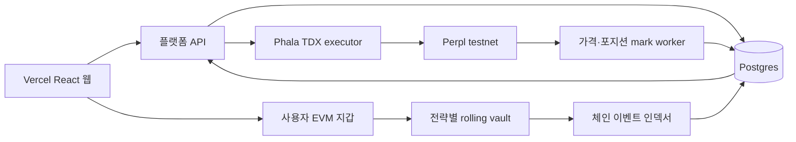

# E2E 참여형 플랫폼 인수 문서

작성일: 2026-10-05  
목표: Monad testnet에서 퀀트 전략가가 과거 기록을 공개하고 API로 전략 target을 제출하며, 투자자가 자기 지갑의 테스트 AUSD로 전략에 입금하고 epoch 단위로 추정 NAV·PnL·환매 상태를 확인하는 E2E 데모를 만든다.

## 현재 상태

### 이미 있는 것

- 공개 프론트엔드: `https://mm-zkquant.vercel.app`
  - 기본 진입점은 `src/web/App.jsx`의 `Platform.jsx`다.
  - 전략가 콘솔에서 브라우저 EVM 지갑의 `personal_sign`을 사용한다.
- Phala production TDX 인스턴스
  - API key hash와 비공개 target 큐는 TEE `/state/platform.json`에 `SealedStore`로 암호화해 보관한다.
  - 구현: `deploy/tee/operator/platform.mjs`
  - HTTP route: `deploy/tee/operator/server.mjs`의 `/platform/*`
  - compose 준비: `MM_TEE_DIR=<새 디렉터리> npm run prepare:cohort:tee`
- 전략별 sleeves 테스트넷 증거
  - `docs/evidence/omnibus-testnet.json`
  - 화면의 기본 BTC 상승, BTC 하락, 현금 유지 전략은 이 과거 snapshot에서 읽는다.
- terminal cohort TEE/Perpl/ZK 테스트넷 증거
  - `docs/2026-10-04-core-cohort-mvp.md`
  - TEE가 target proof를 만들고 Perpl 주문을 제출하며, 종료 시 장부 proof와 2명 투자자 지급까지 검증했다.
- Pilot의 암호화된 전략 제출·epoch aggregation
  - `src/pilot/`
  - `src/pilot/coordinator.js`는 Ed25519 서명, 암호문 보관, epoch seal을 구현한다.

### 현재 코드가 제품 요구를 충족하지 못하는 부분

- 별도 DB가 없다. TEE의 암호화 JSON 파일은 복구·검색·다중 인스턴스·공개 조회용 DB가 아니다.
- `PerplCohortVault.sol`은 **고정된 두 투자자, 운용 중 가입 불가, 전체 종료 정산** 전용이다.
- `OmnibusVault`는 여러 전략의 테스트 회계를 다루지만 operator가 신뢰되는 구조이고 TEE execution과 투자자 공개 API에 연결되지 않았다.
- 프론트엔드 `내 포트폴리오`는 지갑 연결과 입금이 아직 없다.
- API key 발급과 target 큐는 TEE에서 동작하지만, target이 rolling vault 실행으로 이어지지 않는다.
- 현재 표시하는 기본 전략 성과는 과거 테스트 evidence이며 새 전략가의 검증된 과거 실적이 아니다.

따라서 현재 상태를 투자 가능한 플랫폼이라고 표시하면 안 된다. E2E 데모의 완료 기준은 아래 흐름이 실제로 이어지는 것이다.

## 목표 사용자 흐름

### 1. 퀀트 전략가

1. 지갑 연결 후 서명으로 strategist profile을 만든다.
2. API key를 한 번 발급하고 안전하게 보관한다.
3. 전략 이름, 설명, 리스크, 수수료, 공개 가능한 과거 성과를 등록한다.
4. 등록한 전략의 epoch target을 API key로 제출한다.
5. TEE는 target·권한·deadline·리스크 한도를 검증하고 실제 실행 요청을 만든다.
6. 전략가는 제출 receipt, epoch 상태, 실행 결과, 공개 성과를 본다.

### 2. 투자자

1. 전략 목록에서 과거 성과, 위험, 수수료, 운용 상태, 최근 NAV mark를 비교한다.
2. 지갑 연결 후 테스트 AUSD를 approve하고 하나 이상의 전략 vault에 deposit한다.
3. 체인 이벤트를 인덱싱해 투자자 지분과 deposit 상태를 DB에 반영한다.
4. 각 전략의 분 단위 추정 NAV와 PnL, 보유 지분, 환매 가능 epoch를 본다.
5. epoch 규칙에 맞춰 환매를 요청하고, 실제 token transfer와 DB 상태를 대조한다.

### 3. 운영 epoch

1. 입금 창을 닫고 해당 epoch의 share/NAV 기준점을 확정한다.
2. TEE가 strategy target을 받아 정책·서명·deadline을 검증하고 주문을 제출한다.
3. Perpl 포지션, 잔고, 가격을 1분마다 mark한다.
4. mark와 체인 상태로 추정 NAV를 계산해 공개 DB에 기록한다.
5. epoch 종료 시 성과, 수수료, 환매 가능 금액을 확정하고 다음 epoch를 연다.

## 권장 아키텍처

- **Vercel**: React 정적 UI만 담당한다.
- **플랫폼 API**: Vercel과 분리된 Node 서비스다. 지갑 로그인, API key lifecycle, 공개 strategy/NAV API, indexer webhook, DB transaction을 담당한다.
- **Postgres**: 공개 메타데이터, 사용자 관계, share/NAV history, event cursor, 공개 performance record를 저장한다.
- **TEE**: API key 원문이 아니라 target 원문, execution key, proof witness, durable signed transaction journal을 보관한다.
- **온체인 vault**: 사용자 자금과 share를 권위 있게 보관한다. DB는 체인 상태의 캐시·조회 모델이다.

TEE가 DB를 대체하면 안 된다. DB의 비공개 target column도 평문 저장하지 말고 TEE public key로 암호화한 ciphertext와 hash만 저장한다.

## Postgres 최소 스키마

| 테이블 | 핵심 컬럼 | 용도 |
|---|---|---|
| `users` | `id`, `created_at` | 앱 사용자 기본 레코드 |
| `wallets` | `address`, `user_id`, `verified_at` | 서명으로 검증된 지갑 |
| `strategists` | `wallet_address`, `display_name`, `bio`, `status` | 전략가 공개 profile |
| `api_keys` | `id`, `strategist_id`, `key_hash`, `prefix`, `created_at`, `revoked_at`, `last_used_at` | key 원문 없이 lifecycle 관리 |
| `strategies` | `id`, `strategist_id`, `slug`, `name`, `description`, `risk`, `fee_bps`, `status`, `vault_address` | 투자자가 보는 전략 |
| `strategy_versions` | `strategy_id`, `version`, `code_hash`, `config_hash`, `published_at` | 전략 변경 이력·재현성 |
| `performance_records` | `strategy_id`, `period_start`, `period_end`, `nav_start`, `nav_end`, `return_bps`, `source`, `evidence_uri` | 과거 성과와 근거 |
| `epochs` | `id`, `strategy_id`, `sequence`, `deposit_cutoff_at`, `start_at`, `end_at`, `status`, `opening_nav` | epoch lifecycle |
| `target_submissions` | `epoch_id`, `strategy_id`, `ciphertext`, `payload_hash`, `tee_receipt`, `accepted_at` | TEE로 보낸 비공개 target의 공개 commitment |
| `subscriptions` | `tx_hash`, `log_index`, `investor_wallet`, `strategy_id`, `amount`, `shares`, `status` | 입금과 share 발행 |
| `redemptions` | `tx_hash`, `log_index`, `investor_wallet`, `strategy_id`, `shares`, `amount`, `status` | 환매 요청·지급 |
| `nav_marks` | `strategy_id`, `marked_at`, `estimated_nav`, `unit_nav`, `pnl_bps`, `source_block` | 분 단위 추정 NAV |
| `executions` | `strategy_id`, `epoch_id`, `intent_hash`, `tx_hash`, `status`, `position_after`, `proof_hash` | TEE 주문·proof 결과 |
| `chain_cursors` | `chain_id`, `contract_address`, `last_block`, `last_log_index` | 재시작 가능한 indexer |
| `audit_events` | `actor`, `action`, `entity`, `entity_id`, `payload_hash`, `created_at` | 사용자·운영 액션 audit |

필수 unique key:

- `wallets.address`
- `strategies.slug`
- `subscriptions(tx_hash, log_index)`
- `redemptions(tx_hash, log_index)`
- `nav_marks(strategy_id, marked_at)`
- `target_submissions(strategy_id, epoch_id)`

금액은 DB에서 floating point를 쓰지 않고 token 최소 단위 정수 문자열 또는 `NUMERIC(78,0)`으로 저장한다.

## API 최소 계약

### 공개

- `GET /v1/strategies`
- `GET /v1/strategies/:slug`
- `GET /v1/strategies/:slug/performance`
- `GET /v1/strategies/:slug/nav?from=&to=`
- `GET /v1/epochs/:id`

### 지갑 세션

- `POST /v1/auth/challenge`
- `POST /v1/auth/verify`
- `POST /v1/auth/logout`

challenge는 단회 nonce, domain, chain ID, 만료 시각을 포함한다. 서명 확인 뒤 세션 cookie 또는 짧은 access token을 발급한다.

### 전략가

- `POST /v1/strategists`
- `POST /v1/api-keys`
- `DELETE /v1/api-keys/:id`
- `POST /v1/strategies`
- `PATCH /v1/strategies/:id`
- `POST /v1/strategies/:id/performance-records`
- `POST /v1/strategies/:id/targets`

`targets`는 API key를 요구하고, API는 target을 TEE attestation public key로 암호화해 TEE에 전달한다. DB에는 ciphertext, payload hash, TEE receipt만 남긴다.

### 투자자

- `GET /v1/me/portfolio`
- `GET /v1/me/subscriptions`
- `GET /v1/me/redemptions`
- `POST /v1/investment-intents`

입금 자체는 API가 대신 보내지 않는다. API는 approve/deposit calldata를 만들고, 투자자의 지갑이 직접 전송한다. indexer가 확정 이벤트를 읽은 뒤 portfolio API를 갱신한다.

## 온체인 작업

새 **rolling strategy vault**가 필요하다. `PerplCohortVault.sol`을 그대로 확장하지 말고 별도 계약과 상태 전이로 만든다.

최소 요구사항:

- 전략별 vault 하나, 다수 투자자 wallet 지원
- test AUSD `deposit`과 share mint
- epoch 경계에서만 subscribe/redemption 처리
- unit NAV 기준 share 발행과 burn
- `requestRedeem`과 claim 가능한 상태 분리
- fee policy와 HWM 상태를 전략별로 기록
- `Deposit`, `RedeemRequested`, `Redeemed`, `EpochOpened`, `EpochClosed`, `NavCommitted`, `ExecutionRecorded` 이벤트
- vault/epoch/target nonce domain separation
- TEE operator만 Perpl 실행 가능, 전략가의 wallet signature 또는 TEE 검증된 API request가 target 권한을 가져야 함
- 테스트넷 전용 chain ID 10143과 test AUSD만 허용

초기 데모에서는 중도 환매를 다음 epoch로 이월해도 된다. 분 단위 NAV는 **추정치**이며, 확정 share 가격과 분리해 UI에 명확히 표기한다.

## 구현 순서

1. Postgres와 migration을 추가하고 platform API를 Vercel 밖에 배포한다.
2. 현재 TEE의 `platform.mjs` JSON registry를 API/DB 기반 registry로 옮긴다.
3. 공개 strategy list를 evidence import가 아니라 `strategies + performance_records + nav_marks` DB query로 전환한다.
4. 지갑 세션과 API key lifecycle을 구현한다.
5. rolling vault 계약과 deploy script를 작성하고 Monad testnet에 배포한다.
6. faucet 또는 test AUSD 확보 경로를 UI에 연결한다.
7. 체인 indexer를 만들고 deposit/redemption/share event를 idempotent하게 DB에 반영한다.
8. TEE target ingress를 epoch·strategy·vault에 묶고 actual execution receipt를 `executions`에 기록한다.
9. 1분 mark worker를 만들고 Perpl position, venue balance, 가격, block number을 `nav_marks`에 기록한다.
10. 투자자 포트폴리오, 전략 상세, 전략가 콘솔을 DB API로 전환한다.
11. 실제 서로 다른 strategist 1명과 investor 2명 이상으로 testnet E2E를 실행한다.

## 데모 완료 기준

- 전략가가 지갑으로 로그인하고 API key를 발급한다.
- 전략가가 과거 성과 근거를 등록하고 공개 strategy list에 보인다.
- 전략가가 API key로 epoch target을 제출하고 TEE receipt를 받는다.
- 서로 다른 투자자 지갑 둘 이상이 test AUSD를 직접 approve/deposit한다.
- indexer가 deposit과 shares를 DB에 반영한다.
- TEE가 target을 실행하고 tx hash/proof hash를 남긴다.
- 최소 세 개의 1분 NAV mark가 저장되고 UI 차트와 포트폴리오 PnL에 보인다.
- 한 투자자가 redemption을 요청하고 다음 epoch 규칙에 따라 실제 token을 받는다.
- DB를 재시작해도 chain cursor로 상태를 재구성하고 TEE durable journal이 중복 주문을 만들지 않는다.

## 현재 파일 안내

| 파일 | 역할 |
|---|---|
| `src/web/Platform.jsx` | 현재 Vercel 플랫폼 UI. API base는 `VITE_PLATFORM_API_BASE` |
| `deploy/tee/operator/platform.mjs` | 임시 TEE API key·strategy·target JSON registry. DB로 대체 대상 |
| `deploy/tee/operator/server.mjs` | TEE HTTP, attestation, encrypted cohort endpoint, `/platform/*` route |
| `scripts/prepare-cohort-tee.mjs` | TEE source/compose measurement 생성. `MM_TEE_DIR`로 새 실험 디렉터리 지정 |
| `contracts/perpl/PerplCohortVault.sol` | 종료형 2인 cohort. rolling vault로 사용 불가 |
| `contracts/sleeves/OmnibusVault.sol` | 다전략 test asset vault reference. TEE integration 전 |
| `src/pilot/coordinator.js` | encrypted strategy submission/epoch aggregation reference |
| `docs/2026-10-04-core-cohort-mvp.md` | 검증된 cohort/TEE/Perpl/ZK 범위와 한계 |

## 운영 정보

- Phala API token, `.data/`, wallet private key, `client.json` token은 git·문서·프론트엔드에 절대 넣지 않는다.
- Vercel에는 `VITE_PLATFORM_API_BASE`만 공개 환경 변수로 설정돼 있다. API key나 TEE access token은 넣지 않는다.
- 현재 TDX는 `tdx.small`이며 계속 실행하면 compute와 disk 비용이 발생한다. 플랫폼 API를 외부 API 서버로 이전한 뒤 TEE는 epoch execution 시에만 켜는 방식으로 비용을 줄일 수 있다.
