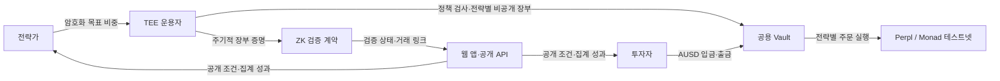

# MM-ZKQuant 발표 자료 초안

> 2026-10-07 발표용 · 약 5분, 8장 구성 · 영상은 60초 내외로 편집
>
> 슬라이드에는 **화면 문구**만 넣고, **발표 메모**는 발표자 노트로 옮긴다. 프로젝트의 대외 명칭이 Veilvest로 확정됐다면 표지의 이름만 교체한다.

## 1. 문제와 동기

### 슬라이드 1 — 표지

**화면 문구**

> **MM-ZKQuant** 
> 전략은 보호하고, 운용 결과는 확인한다

- 비공개 퀀트 전략을 위한 투자·실행 플랫폼
- Monad × Perpl × TEE × ZK

**발표 메모** — 전략가는 자신의 매매 아이디어를 지키고 싶고, 투자자는 어디에 투자하는지 판단할 근거가 필요합니다. MM-ZKQuant는 이 두 요구를 하나의 테스트넷 제품 흐름으로 연결합니다.

### 슬라이드 2 — 왜 필요한가

**화면 문구**

| 전략가 | 투자자 |
| --- | --- |
| 목표 포지션·운용 로직은 경쟁력 | 성과·위험 한도·보수·전략가 자기자본을 확인해야 함 |
| 세부 거래 공개는 전략 복제 위험 | 불투명한 운용에는 자본을 맡기기 어려움 |

**핵심 질문:** 전략의 민감한 입력을 숨기면서 투자자가 운용과 정산을 확인할 수 있을까?

**발표 메모** — 이 프로젝트의 출발점은 수익률 예측이 아니라 정보 공개의 경계입니다. 전략가에게는 비공개 목표 제출 경로를, 투자자에게는 공개 조건과 실제 테스트넷 거래·지급 기록을 제공합니다.

### 슬라이드 3 — 제품이 제공하는 경험

**화면 문구**

1. 전략가: 지갑 로그인 → 전략·위험 조건 등록 → 자기자본 입금 → **암호화 목표 비중 제출**
2. 투자자: 공개 조건 비교 → AUSD 입금 → 다음 목표 제출 때 지분 편입 → 정산 출금
3. 공통: 실제 체결·공개 성과·장부 증명 상태 확인

**한 줄 메시지:** 비공개 운용 입력과 투자 판단에 필요한 공개 정보를 분리한다.

**발표 메모** — 투자자의 새 입금은 즉시 기존 운용 손익에 섞이지 않고 대기합니다. 다음 목표 제출 때 당시 순자산을 평가한 가격으로 지분을 발행합니다. 출금은 약정한 마감과 정산 시각에 처리합니다.

## 2. 핵심 아키텍처

### 슬라이드 4 — 자금·데이터 흐름

**화면 문구**

- **하나의 Vault:** 자금 입출금의 공통 진입점
- **TEE:** 암호화 목표, 전략별 지분·정산 장부, 실행 계정 귀속 관리
- **Perpl:** 실제 주문과 포지션이 발생하는 거래소
- **ZK 체크포인트:** 장부 전이의 계산 일관성을 주기적으로 공개 검증

**발표 메모** — 브라우저와 전략 클라이언트가 목표 비중을 TEE 공개키로 직접 암호화합니다. 공개 API는 목표 평문을 중계하지 않습니다. 전략 주문은 서로 합산하거나 상쇄하지 않고 독립적으로 실행합니다. 공용 Vault를 쓰되 전략별 장부는 TEE 안에서 분리합니다.

### 슬라이드 5 — TEE와 ZK가 각각 검증하는 것

**화면 문구**

| 계층 | 현재 역할 |
| --- | --- |
| TEE | 목표 복호화, 서명·위험 조건 검사, 주문·출금 처리, 비공개 장부 유지 |
| ZK 장부 증명 | 입금 편입·지분·보수·출금 등 장부 계산을 약 5분 단위로 검증 |
| 공개 체인 | Vault 입출금, Perpl 거래, 체크포인트 거래를 확인 가능 |

**정확한 범위:** 현재 플랫폼의 ZK는 **사후 장부 체크포인트**다. 모든 주문이 실행 전에 ZK proof로 승인되는 구조는 아니다.

**발표 메모** — ZK proof의 공개 입력은 체인·Vault·증명 순서·시각·이전/다음 root 등으로 제한합니다. 투자자별 금액이나 전략 연결표는 공개하지 않습니다. 다만 실제 가격, 체결, 송금액이 참인지와 주문 위험 정책 실행 여부는 이 장부 회로만으로 증명하지 않습니다.

## 3. 데모 영상

### 슬라이드 6 — 제품 데모 (영상 재생)

**화면 문구**

> **영상 삽입:** `[데모 영상 파일 또는 URL]` 
> 전략 선택 → 암호화 목표 제출 → Perpl 체결 → 투자자 정산 → ZK 체크포인트

**권장 영상 구성 (총 60초)**

| 구간 | 보여줄 화면 | 자막 |
| --- | --- | --- |
| 0–10초 | 공개 전략 목록과 위험·보수 조건 | “투자자는 공개 조건을 비교” |
| 10–22초 | 전략가 화면에서 목표 비중 제출 | “목표 비중은 TEE로 암호화 전송” |
| 22–34초 | 실행 상태와 Monad 탐색기의 Perpl 거래 | “실제 테스트넷 체결 확인” |
| 34–47초 | 투자자의 출금 상태와 ERC-20 지급 영수증 | “지분·출금은 전략별 장부로 정산” |
| 47–60초 | 전략가/투자자 화면의 ZK 증명 상태와 체크포인트 거래 링크 | “장부 전이를 공개 proof로 재검증” |

**발표 메모** — 영상에 과거 거래를 보여줄 경우 해당 거래 시점과 탐색기 링크를 화면에 함께 표시합니다. 출금 대기 시간을 편집할 때는 “요청”과 “정산 완료”를 다른 시점으로 명확히 표시합니다. 현재 저장소에서는 영상 파일을 확인하지 못했으므로 이 슬라이드의 링크는 녹화 후 교체해야 합니다.

## 4. 결과 및 한계

### 슬라이드 7 — 확인한 결과

**화면 문구**

- **실제 테스트넷 흐름:** 전략 등록·자기자본 입금·암호화 주문·후속 투자자 편입·예약 출금·ERC-20 지급 확인
- **복수 전략 실행:** BTC/ETH 거래와 별도 전략의 BTC 숏을 동시에 체결; 서로 반대 주문을 상쇄하지 않음
- **부분 출금:** 투자자에게 **50.003593 테스트 AUSD** 지급, 남은 지분 유지
- **장부 ZK:** genesis부터 **9개 proof 독립 검증**; 실제 0.01 테스트 AUSD 입금 후에도 체크포인트 지속, TEE 재시작 전후 root·순서 유지
- **자동 검증:** 플랫폼 인수 문서 기준 **448개 테스트 통과**

**발표 메모** — 결과는 테스트넷 자산과 검증 시나리오의 관측치입니다. 부분 출금액은 한 시나리오의 지급액이며 수익률이나 투자 성과를 뜻하지 않습니다. ZK 검증 거래는 [Monad 탐색기](https://testnet.monadscan.com/tx/0xbfded43782cd6b0a1b6a86d1711575b8a2fdc9e8c237d07549b5a09b36d914ce)에서 확인할 수 있습니다.

### 슬라이드 8 — 한계와 다음 단계

**화면 문구**

| 현재 한계 | 다음 검증 |
| --- | --- |
| 테스트넷 시나리오이며 장기 수익성·실자금 운용은 검증 전 | 실제 사용자·장기간 운용 관측 |
| 장부 proof는 사후 검증; 모든 주문의 ZK 사전 승인은 미연결 | 주문·위험 정책 증명 경로 확장 |
| 온체인 주문의 시각·금액에서 전략을 추론할 여지 | 프라이버시 위협 모델과 공개 범위 검토 |
| 체결·출금은 Perpl 유동성·최소 금액·가스에 의존 | 실패·부분 체결·재시작·비상 출구 검증 |
| 브라우저의 요청 전 attestation 검증은 코드에 연결했으며 배포 확인이 남음; 단일 참여자 Groth16 설정과 TEE 운영 신뢰도 남음 | 배포 후 실패 차단 확인, 다자 설정·독립 감사·운영 복구 |

**마무리 문장:** “비공개 전략을 맡기는 경험부터 거래·정산·증명까지 테스트넷에서 연결했습니다. 다음 과제는 검증 범위와 운영 신뢰를 넓히는 것입니다.”

## 발표 전 교체·확인 항목

- `[데모 영상 파일 또는 URL]`을 실제 영상으로 교체하고 영상 길이를 확인한다.
- 영상 속 거래·출금·증명 링크가 **각각 어떤 시나리오의 기록인지** 표시한다.
- 발표 직전 배포 화면의 증명 상태와 링크를 열어보고, 실시간 상태가 다르면 슬라이드의 과거 검증 결과로 설명한다.

## 내부 근거 자료

- [현재 플랫폼 구조·사용자 흐름·448개 검증](e2e-platform-handoff.md)
- [주기적 플랫폼 장부 ZK 범위·9개 proof 결과](platform-ledger-zk.md)
- [장부 ZK 검증 결과 원자료](evidence/platform-ledger-validation.json)
- [별도 코어 cohort 실험: 주문 ZK와 2인 종료 정산](2026-10-04-core-cohort-mvp.md) — 슬라이드 5의 현재 플랫폼 기능과 혼동하지 않도록 본문 수치에서 제외
